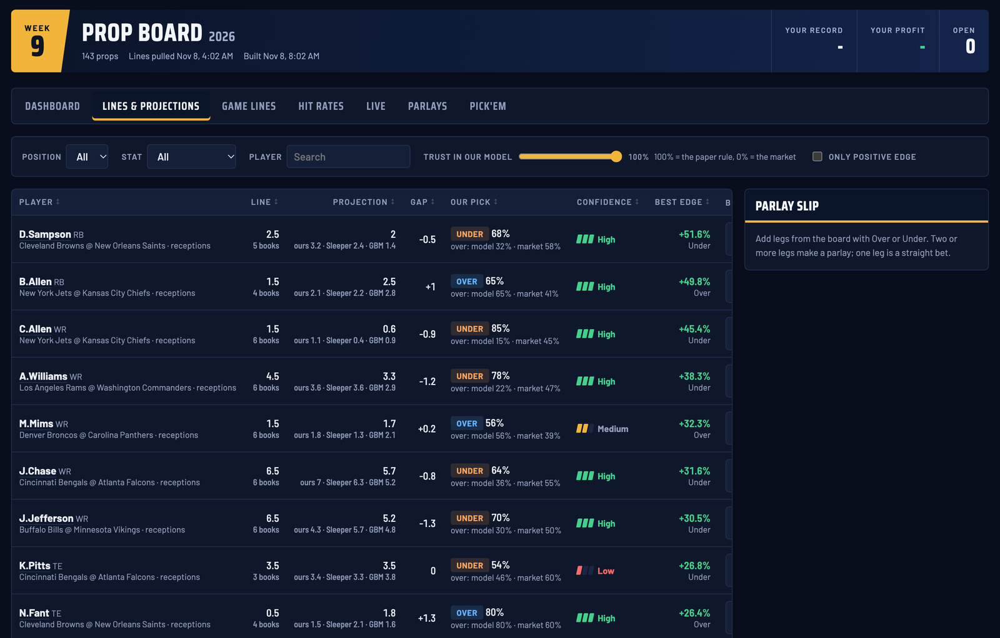

# NFL Player Prop Model

Projects NFL players' passing, rushing, receiving and reception stats each week, turns those projections into probabilities, and tests them against real sportsbook lines with a rules-based paper-trading system.



## Results (2026 season, live paper trading)

- **Calibration:** on held-out sportsbook lines, the receptions model's probabilities matched the market's own accuracy (log loss 0.650 vs. 0.660, 116 lines).
- **Bet filters:** several filters were frozen before their test weeks and then run forward. The best one won 64.1% of its bets against a 53.9% break-even (132–74, weeks 7–8), about 10 percentage points over break-even.
- **Volume:** 100+ paper bets a week, placed and settled automatically.

These are small samples from one season. The experiment notes in `docs/` record every test that failed as well as the ones that passed.

## How it works

1. **Data:** `StatScraper.py` pulls nflverse play-by-play and player stats into SQLite.
2. **Features:** rolling, as-of-date features per player and opponent (`src/features/`). Tests check that no feature can see the game it predicts.
3. **Models:** an LSTM (`PlayerProjections.py`), a Transformer (`PlayerProjectionsTransformer.py`) and a gradient-boosted model (`GbmProjections.py`), blended with Sleeper's public projections.
4. **Probabilities:** each projection's historical error distribution becomes a "hit-rate ladder" that gives P(over) at any line (`site_data.py`).
5. **Lines:** live odds come from The Odds API and ESPN's DraftKings feed (`log_props.py`, `log_closing.py`).
6. **Paper trading:** `paper_trades.py` bets only when the model's chance beats the price's break-even, then settles from box scores and tracks closing-line value.
7. **Dashboard:** a React + TypeScript app (`site/app/`) shows the week's board, live games and the running record.

A separate pipeline in `src/` predicts game winners, with its own walk-forward backtest and reports.

## Setup

```bash
python3 -m venv .venv && source .venv/bin/activate
pip install pandas numpy pyarrow scikit-learn fastparquet appdirs torch transformers
pip install --no-deps nfl_data_py   # its metadata pins an old pandas; see requirements.txt
```

Live odds need a key from The Odds API in the `ODDS_API_KEY` environment variable.

```bash
python3 weekly_props.py           # project the upcoming week and log prop lines
python3 paper_trades.py place 2026 10
python3 paper_trades.py settle 2026 10
python3 site_data.py 2026 10      # build the dashboard's data
cd site/app && npm install && npm run dev
```

## Tests

Tests are plain scripts using `assert`. Most use synthetic data and need no network:

```bash
python3 test_ladder.py
python3 test_sleeper_blend.py
python3 tests/test_train.py
python3 tests/test_backtest.py
cd site/app && npm test
```

## Tools

Python, PyTorch, Hugging Face Transformers, scikit-learn, pandas, SQLite, TypeScript, React, Vite.

Built with help from AI coding assistants. The modeling choices, experiments and evaluation are my own.
